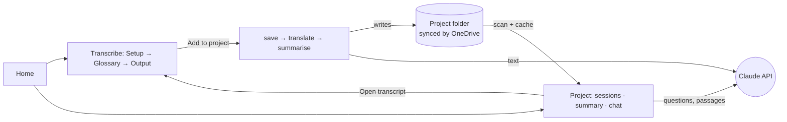
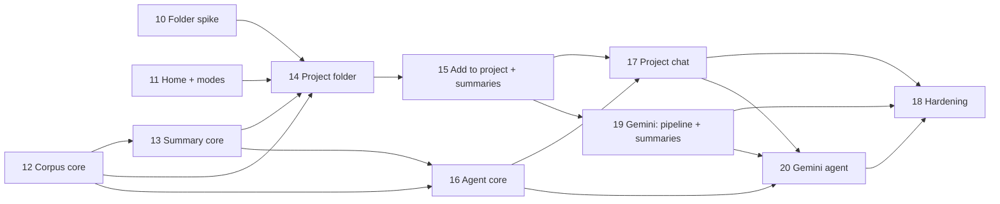

# DeScribe 2 — Projects

*Architecture for release 2, approved by the product owner on 2026-10-15. The decisions in §2 are summarised in
[DECISIONS.md](DECISIONS.md) D20–D23 and T11–T13. Each phase in §8 has its own file in [phases/](phases/), and
[ROADMAP.md](ROADMAP.md) §7 tracks their status. Agents on a release-2 phase read this file after ROADMAP.md.*

## 1. Purpose

A research team will record 250–300 hours of interviews and ethnographic sessions. Release 2 helps them:

1. **Find quotes** that answer a question ("What do people say about charging at night?"). *Primary.*
2. **Read a summary of each session:** themes, key moments, quotes and respondent details. *Primary.*
3. **Explore themes** and compare sessions across the corpus. *Secondary.*

It has to work while fieldwork is still going on, with no upkeep: no embeddings, no index to rebuild, no server. A
session is useful as soon as it has been added.

## 2. Agreed with the product owner (2026-10-15)

| # | Decision | Consequence |
|---|---|---|
| A1 | A **project** is a shared folder that OneDrive (or SharePoint sync) keeps on each researcher's computer. It holds every session's **transcript and summary**. Recordings stay out. | Anyone on the team can open any session, and the agent can read every original. Playback still needs the recording attached locally. |
| A2 | The **transcript is the research object**, whatever the number of respondents. | Metadata belongs to the session and lists the respondents in it. There is no register of respondents across sessions. |
| A3 | **Themes:** a shared **project brief** (research questions, discussion guide) guides every summary, and the agent adds emergent themes. | One `describe-project.json` per project. Summaries reuse theme names the project already uses. |
| A4 | **Everything in English:** summaries and quotes. | Adding a session in another language translates it to English first, with the existing translation. Search and quotes work on the English text. A quote from a translated session says so. |
| A5 | Summaries are **JSON, read only through DeScribe**. | No .docx or .md copies. Project mode needs a summary view. |
| A6 | **Claude only** for summaries and chat. *Changed 2026-10-21 (D26): Claude or Gemini. Summaries and the pipeline get Gemini in Phase 19, the chat in Phase 20.* | One agent implementation until Phase 20. Translation on the Output tab keeps offering Gemini. |
| A7 | **The agent extracts respondent metadata.** | The fields come from the brief's list, plus anything else notable. The agent also sees the recording's file name and the speaker labels, so a file named `P07 Hamburg…` puts those details in the metadata. |
| A8 | **No backlog:** every session will be transcribed with DeScribe 2. | No import of old .docx transcripts. |
| A9 | **Chats are not kept.** *Changed 2026-10-27 (D29, Phase 21): chats are saved in the project folder's `chats/`, and colleagues can read them.* | A conversation lasts until **New chat** or until the tab closes. Nothing about chats is stored. *From Phase 21: the Chats tab lists them and opens one again.* |
| A10 | **The agent runs to the end, within a per-question cap.** What it searched and read is shown, collapsed. | The caps live in one file. Each answer can show its approximate cost. |
| A11 | **Summaries aren't edited**, only regenerated. | To fix a summary, fix the transcript, the speaker names or the brief, then **Regenerate**. |
| A12 | Quotes leave DeScribe through **Copy with citation**. | No quote collections or .docx answers in this release. |
| A13 | A **Home page** offers two modes: **Transcribe** (today's Setup → Glossary → Output) and **Project**. | The `nav` store gets a `mode`. The transcription flow doesn't change. |
| A14 | A session joins a project through an **Add to project** button on Output: save, translate if needed, summarise. | Test recordings stay out unless someone adds them. |
| A15 | People are named **by their speaker labels**. There is no automatic pseudonymisation. | The team's own data rules apply. The prompt tells the agent to use the labels. |
| A16 | Researchers get their **own keyword search box** in Project mode, using the agent's search engine. | An exact search across all transcripts, with **Copy** on each hit. It also lets researchers check what the agent found. |
| A17 | **Claude Sonnet 5.5 is the default** for project work, with **Opus 5.5 as the option**. The choice is saved on each computer. *From Phase 19 (D26), Gemini models are options too.* | One select in Project mode, used for the pipeline's translation, for summaries and for chat. A change takes effect on the next chat. The Translate dialog keeps its own choice (T7). |
| A18 | **Caps per question:** 250k tokens of transcript text and 30 tool calls. | Kept in one file (§5.5) and tuned after the live checks. |

## 3. Scale

| Quantity | Estimate | Consequence |
|---|---|---|
| Corpus | 250–300 h, about 150–300 sessions | |
| English text | ~8,300 words an hour, so ~13k tokens an hour including turn ids and times | The corpus is ~4M tokens. That doesn't fit in one 1M-token context, so the agent must choose what to read. |
| Session card (title, date, respondents, synopsis, theme names) | ~200 tokens | All the cards together are ~60k tokens. They go in every request and are cached. |
| Full summary | ~2–3k tokens | All the summaries together are ~750k tokens, so the agent reads them a few at a time, as it needs them. |
| Transcript file, with word timings | ~0.6–0.7 MB an hour | ~200 MB per project in OneDrive. Each computer reads a file once and caches the text (§5.4). |
| Text kept in memory for search | ~100 KB an hour | ~30 MB for 300 hours. Scanning every turn is fast enough (§5.4). |

**Rough cost** with the default, Claude Sonnet 5.5: $2 per million input tokens, $10 per million output tokens,
and $0.20 per million cached reads. Opus 5.5 costs twice as much for input and output ($4 / $20), and the same for
cached reads. These are estimates; the live checks (§6) measure them.

| Work | Sonnet 5.5 | Opus 5.5 |
|---|---|---|
| Summarising a 1-hour session (~15k tokens in, ~6k out including thinking) | ≈ $0.10 | ≈ $0.20 |
| Summarising 300 hours | ≈ $30 | ≈ $60 |
| A question that reads passages from 10–15 sessions | $0.25–1 | $0.50–2 |
| A question at the cap (§5.5) | about $2 | about $3 |

- Translating an hour in another language costs about the same again as summarising it.
- A question's cost is mostly for the passages it reads. The cards are cached across the conversation.

## 4. Three design choices

1. **The project folder is a folder on disk that OneDrive syncs.** DeScribe reads and writes it through the
   browser's File System Access API (`showDirectoryPicker`). Microsoft Graph would need an Azure app registration,
   which means IT approval, plus new network hosts. That would break Product Principles 1 and 3. The risk is that
   the API isn't yet proven on `file://` with OneDrive's Files On-Demand, so Phase 10 checks that before anything
   is built on it.
2. **Agentic keyword search, not embeddings.** The agent sees a card for every session. It runs its own keyword
   queries over all the transcripts: word variants, synonyms, and terms in the session's own language when it
   searches the originals. It reads full summaries and transcript passages only where they matter. Adding a session adds one
   more file to the folder, with nothing to re-index or re-embed.
3. **Quotes are pointers that the app checks.** The agent writes a quote as `<quote ref="s12/t412">…</quote>`.
   DeScribe checks that the words appear in that turn, then shows the transcript's own text with the citation. A
   quote that can't be found is marked, and is never presented as verified.

## 5. Architecture

The contracts in this section are sketches. The phase files hold the final versions.

### 5.1 Overview



The only network traffic goes to `api.anthropic.com`, which is already allowed. The project folder is on the local
disk, and OneDrive shares it outside DeScribe.

### 5.2 Project folder

```
<project folder>/                     chosen by the researcher, inside their OneDrive
  describe-project.json               name and brief (rarely edited)
  sessions/
    P07-Hamburg-home-visit--3f9a1c2e.transcript.json
    P07-Hamburg-home-visit--3f9a1c2e.summary.json
    …
  chats/                              saved chats, one file per chat (D29, Phase 21)
    2026-10-27-1402--7b1d4c3a.chat.json
```

- **Chats** (Phase 21, D29): `chats/<start in UTC>--<id8>.chat.json`, written only by the browser of the chat's
  author (`domain/chat.ts`, `storage/chatFiles.ts`). A colleague's chat is read, and continuing it saves a copy.

- **One flat `sessions/` folder,** so one directory listing finds everything. A file's name is the recording's
  name (made safe for file names) plus the first 8 characters of `TranscriptDoc.id`. That keeps it unique and
  recognisable. DeScribe identifies a session by the `id` inside the file, never by the file name.
- **Two files per session,** because they change at different times. The transcript changes when someone edits
  it. The summary changes when someone regenerates it.
- **People write only the files they act on,** and there's no shared index file to fight over.
  - Two people seldom write the same file at the same moment. It happens when both regenerate one summary, or both
    edit one transcript.
  - Writes use `createWritable()`, which replaces a file in one step.
  - Before autosaving a transcript, DeScribe checks that the file hasn't changed since it was opened. If it has
    changed, autosave stops and the user picks **Reload** or **Keep mine**.
  - DeScribe recognises OneDrive's conflict copies (`….summary-LAPTOP-123.json`: OneDrive puts the device name
    before `.json`, Phase 10) by their duplicate `id`. The copy with the newest `savedAt` wins. The session view
    mentions the other copy in a `<details>`.

**Contracts.** The zod schemas live in `storage/projectFiles.ts`. `TranscriptDocSchema` moves from
`storage/idb.ts` to `storage/schemas.ts` so both files can use it.

```ts
// describe-project.json
interface ProjectFile {
  kind: 'describe.project';
  schemaVersion: 1;
  id: string;                     // uuid
  name: string;
  createdAt: string;              // ISO
  updatedAt: string;
  brief: {
    researchQuestions: string[];  // one per line in the editor
    context: string;              // objectives, discussion guide, anything the summariser should know
    metadataFields: string[];     // respondent details to extract, e.g. 'Age', 'Country', 'Hearing aids used'
  };
}

// sessions/<base>.transcript.json
interface SessionTranscriptFile {
  kind: 'describe.transcript';
  schemaVersion: 1;
  savedAt: string;
  doc: TranscriptDoc;             // schema v1 unchanged, including translations.en
}

// sessions/<base>.summary.json
interface SessionSummaryFile {
  kind: 'describe.summary';
  schemaVersion: 1;
  sessionId: string;              // TranscriptDoc.id
  createdAt: string;
  model: string;                  // the model that was chosen
  transcriptHash: string;         // turn texts, speaker labels and English texts the summary was made from
  briefHash: string;              // the brief it was made with
  droppedQuotes: number;          // quotes removed because they weren't found in the transcript
  summary: SessionSummary;        // §5.3
}
```

The new files have their own `kind` and `schemaVersion`, so D18 applies to them from the start. A build keeps the
fields it doesn't know when it writes a file back (D38). The handle to the folder is kept in IndexedDB under
`describe.v1.projectFolder`. That is a new key, not a change of shape.

**Permissions.**
- The first time, **Open project…** or **New project…** opens the folder picker.
- On later visits, DeScribe asks the browser whether permission is still granted. If it isn't, DeScribe shows
  **Reconnect "<name>"**, and one click asks for it again. The browser requires that click.
- On `file://` the browser never offers "Allow on every visit" (Phase 10). Access ends when the browser closes, so
  **Reconnect** is needed once per browser session.

### 5.3 Add to project and session summaries

**Add to project** sits in the Output actions row, next to **Translate**. Like translation (D14), it shows its
progress, **Cancel** and **Resume** in the row. It runs these steps:

1. **Connect.** If no project is connected, a dialog opens or creates one. If the key for the project model's
   provider is missing, it can be entered there (Claude until Phase 19, then Claude or Gemini, D26).
2. **Save** the transcript file. From then on, the Output tab's autosave writes to this file too.
3. **Translate,** if the language isn't English and there's no English translation yet. This uses
   `translateTranscript` with the project model and its provider (A17). An existing translation from either provider
   is kept.
4. **Summarise** (below) and write the summary file.

Project mode runs the same pipeline from step 3:
- **Summarise** a session that has no summary.
- **Regenerate** a summary that is out of date, failed, or was made with an older brief.
- **Summarise all (N)** runs a queue one session at a time, with progress and **Cancel**.

A summary is **out of date** when its `transcriptHash` or its `briefHash` no longer matches. It's still shown,
with **Regenerate**.

**The summary call** is one structured-output request, `LlmProvider.generateStructured`, with the project model.
Phase 13 makes it stream internally, so long sessions don't hit timeouts. The input is:
- the brief;
- the theme names the project already uses, with how often each is used, so summaries reuse them where they fit
  (A3);
- the recording's file name, date and duration, and the speaker labels;
- every turn, written as `t412 [00:41:12] Anna: <English text>`.

Even a 10-hour session, about 130k tokens, fits in one request.

```ts
// The model's output (zod schema in features/summary/schema.ts). Turn ids must exist in the transcript.
interface SessionSummary {
  title: string;                  // short, e.g. "P07 – home visit, Hamburg"
  synopsis: string;               // 2–3 sentences; used in the session card
  overview: string;               // 250–500 words
  respondents: {
    speakerId: string | null;     // null for a person who is mentioned but isn't a speaker
    label: string;
    attributes: { field: string; value: string; turnIds: string[] }[];  // the brief's fields first, then others
  }[];
  researchQuestions: {            // one per question in the brief
    question: string; finding: string; turnIds: string[];
    quotes: { turnId: string; text: string }[];          // 0–2, respondents' own words
  }[];
  themes: {
    name: string; description: string; turnIds: string[]; isNew: boolean;
    quotes: { turnId: string; text: string }[];          // 0–2, respondents' own words
  }[];
}
```

The app checks every reply before saving it (`features/summary/check.ts`):
- It drops unknown turn ids.
- It checks each quote against its turn (§5.5). Quotes that aren't found are removed and counted in
  `droppedQuotes`.
- If more than a third of the quotes fail, it sends the request once more.

Summaries first had separate key moments and a list of 8–15 quotes. Before release 2 shipped, these were replaced by
the quotes under each finding and theme (D21).

### 5.4 Corpus text and keyword search

**Loading.** When a project opens, DeScribe:
1. lists `sessions/`;
2. reads every summary file (they're small);
3. builds a `SessionText` for each transcript: the turns with their id, speaker, start time, original text and
   English text, without word timings.

`SessionText`s are cached in IndexedDB, keyed by file name, `lastModified` and size, so a file is read again only
when it changes.
- The first time a project opens on a computer, DeScribe reads every file once and shows progress ("Reading 120
  of 300 sessions").
- When the window gets focus, DeScribe rescans the folder, which picks up colleagues' new sessions. A rescan
  costs one listing plus the files' sizes and dates.
- The corpus is held in a `shallowRef` (AGENTS.md rule 8).

**Search** lives in `domain/corpus/search.ts`, which is pure TypeScript. Each turn's text is normalised once:
lower case, accents removed (NFKD, then the combining marks are dropped), `ß` → `ss`, and typographic quotes made
plain. A query is then a scan over every turn, like grep, with no index to build or keep up to date.
- **Syntax:** words (all of them must appear in the turn), `"exact phrases"`, `prefix*`, `OR` and `-exclude`.
- **Options:** only some sessions; the English text, the original or both.
- **Results:** grouped by session. Each hit has its turn id, time, speaker label and a snippet.
- **Budget:** under 200 ms per query on a generated 300-hour corpus, on the maintainer's laptop (perf test).
  Build an inverted index only if the perf test misses this budget.

This is the agent's search tool. The same engine drives the researchers' search box in Project mode (A16).

### 5.5 The project agent

**Loop.** A Claude tool-use loop runs in the browser, in `providers/llm/claudeAgent.ts`:
- It is a manual streamed loop, not the SDK's tool runner: after a mid-output refusal fallback, the API wants some
  blocks left out when the turn is sent back, and the runner would send them (reference/llm-providers.md). The loop
  is shared with Gemini, in `providers/llm/agentLoop.ts`.
- The model is the project model: Sonnet 5.5 by default, or Opus 5.5 (A17). The effort is set explicitly to
  `medium`, because the two models have different API defaults.
- A conversation keeps the model it started with. Thinking blocks belong to one model, and switching would also
  invalidate the cache.
- It sends the server-side refusal fallback, as T9 does for translation.
- The phase agent loads the `claude-api` skill before writing it.

**Gemini (Phase 20, D26).** `providers/llm/geminiAgent.ts` implements the same `AgentProvider`, so the features, the
tools, the caps and the chat stay the same. It is a manual function-calling loop over `generateContentStream`.
- The conversation keeps every model turn exactly as it was received, with its thought signatures.
- Caching is Gemini's implicit caching, so the order of the request (instructions, context, conversation) matters
  as it does for Claude.
- A conversation keeps the provider and the model it started with.
- Until Phase 20 is done, the chat is offered only with a Claude model.

The provider hides the SDK's types behind a small interface. The conversation is an opaque, append-only value,
because thinking blocks must be passed back unchanged.

```ts
// providers/llm/types.ts (additions)
interface AgentTool<I> {
  name: string;
  description: string;
  input: z.ZodType<I>;
  run(input: I, signal: AbortSignal): Promise<{ content: string; activity: string }>;  // activity: one line for the UI
}
type AgentEvent =
  | { type: 'text'; delta: string }
  | { type: 'retry'; discard: number }  // a request sent again: the last `discard` characters of text go
  | { type: 'tool'; name: string; activity: string; isError: boolean }
  | { type: 'usage'; inputTokens: number; cacheReadTokens: number; cacheWriteTokens: number; outputTokens: number };
interface AgentProvider {
  readonly model: string;
  run(req: {
    instructions: string;                 // fixed; cached
    context: string;                      // brief + session cards, frozen for the conversation; cached
    tools: AgentTool<unknown>[];
    conversation: AgentConversation | null;
    userMessage: string;
    maxIterations: number;
    signal: AbortSignal;
    onEvent(e: AgentEvent): void;
  }): Promise<{ text: string; conversation: AgentConversation; stopped: 'done' | 'limit' }>;  // throws ProviderError
}
```

**What the agent sees.** The order puts what changes least first, so caching works:
1. **Instructions** (fixed):
   - How to research: start from the cards, run several keyword queries with variants and synonyms (and terms in
     the session's language for the originals), read passages around the hits, and read whole sessions only when
     needed.
   - Write in English. Say when the evidence is thin. Never quote anything it hasn't read.
   - The quote format, and the small Markdown subset that the UI renders.
2. **Context,** frozen when the chat starts: the brief, and one card per session, sorted by date and keyed
   `s1…sN`. Short keys keep the prompts small, as T5 does for turns. A session with no summary yet gets a card
   with its file name, language and duration, and its transcript can still be searched.
3. **The conversation.** Every turn of the tool loop resends it, and automatic caching keeps that cheap.

| Tool | Input | Returns |
|---|---|---|
| `search_transcripts` | A query (syntax above); optionally session keys; `english`, `original` or `both`; a page number | Hits grouped by session, at most 5 per session and 60 per call, each with turn ref, time, speaker and snippet; the total count |
| `get_summaries` | Up to 10 session keys | The full summaries, as compact text |
| `read_transcript` | A session key, and either `around` a turn (± N turns) or `from`–`to`. Neither means the whole session. | Turns written as `t412 [00:41:12] Anna: …` |
| `list_themes` | – | Every theme name with its session keys and counts, taken from the summaries. This serves goal 3. |

All the tools only read. None of them can write files or reach the network. Transcript text is untrusted input,
but a prompt injection hidden in a transcript can at worst mislead an answer, and the quote check limits even
that.

**Caps,** kept in one place (`features/agent/limits.ts`):
- **Transcript text per question:** 250k tokens, about 20 hours. After that, `read_transcript` replies "Limit
  reached. Answer from what you have."
- **Tool calls per question:** 30.

Two notices cover the rest:
- Once a chat passes about 600k tokens: "This chat is long. Type /compact to summarise it, or start a new chat."
  `/compact` has the agent summarise the chat and go on from the summary (Phase 22, D33).
- When sessions are added during a chat: "3 new sessions. Start a new chat to include them." Changing the frozen
  context would invalidate the cache.

**Answers.**
- **Rendering:** our own code turns a small Markdown subset (paragraphs, short headings, lists, bold, italic) into
  Vue nodes. Never use `v-html`: the CSP allows inline script, so model output must never become HTML.
- **Quotes:** `<quote ref="s12/t412">…</quote>` becomes a quote card.
- **The quote check** (`domain/corpus/quoteCheck.ts`): the quote is split at `…`. Each part, normalised as for
  search, must appear in order in the turn's English text. For English sessions it's the original text.
  - **Verified:** the card shows the transcript's own text, the speaker, the time and the session title. **Copy**
    puts it on the clipboard as `"…" — Anna (P07), 00:41:12, P07 – home visit, Hamburg (translated from German)`.
  - **Not found:** the card is marked, and it has no **Copy** button.

**Activity.** Under each answer, a collapsed `<details>` lists the tool activity, for example "Searched
*charg\* night* · 23 hits in 9 sessions" and "Read P07 00:38–00:47". It also gives the approximate cost, worked out
from the usage events and a price table in `models.ts`.

**Stop** cancels a running answer. **New chat** clears the conversation.

### 5.6 UI

- **Home** (new): **Transcribe** and **Project** as two large buttons. The **Project** button shows the remembered
  project's name. **Home** at the start of the header leads back to it. No intro text (D13).
- **Transcribe mode** is unchanged, apart from **Add to project** in the Output actions row.
- **Project mode** puts two panes side by side (every page is 80rem wide, D24), and stacks them on narrow windows:

```
DeScribe                                                    Hearing at home 2026 · Brief · Change
┌─────────────────────────┬──────────────────────────────────────────────────────────────┐
│ Sessions 42             │  You: quotes about charging at night                         │
│ P01 Hamburg  DE   ✓     │  ▸ 6 searches · read 5 sessions · ≈ $0.40                    │
│ P02 Lyon     FR   ✓     │  People who charge overnight describe it as a routine …      │
│ P03 Leeds    EN   ◐     │  ┌──────────────────────────────────────────────────────┐    │
│ P04 Aarhus   EN   ⟳     │  │ "I just put them on the charger by the bed, like my  │    │
│ …                       │  │  phone."  Anna (P02) · 00:41:12 · translated   [Copy] │    │
│ [Summarise all (3)]     │  └──────────────────────────────────────────────────────┘    │
│                         │ [Ask about the project…                        ] [Send]     │
│                         │ (Chat | Search)                                              │
└─────────────────────────┴──────────────────────────────────────────────────────────────┘
```

- **Sessions list:** each session shows its title (the file name until it's summarised), its language and its
  status. The statuses are: summarised ✓, summarising ◐, out of date ⟳, failed, and no summary.
- **Sidebar tabs** (Phase 21, D29): **Sessions N** and **Chats N** above the list. The Chats tab lists the saved chats,
  the last one added to first, each with its title, "You" or the colleague's name, and the time. Selecting one opens
  it in the chat pane; the pane opens on a new chat.
- **Search** in the chat pane (A16, D30): **Chat | Search** under the question box switches the pane to the search box,
  and its results take the conversation's place: hits grouped by session, each with the speaker, time, snippet and
  **Copy**. A session lists its first 4 hits; **Show all** under them lists the rest below them, and **Show fewer**
  goes back to 4 without moving the button. A click on a hit (or its speaker and time, a button) opens it to its whole
  turn without moving the snippet's words: the rest of the turn follows them in a box at least three lines tall (and a
  line taller than the snippet), and the turn before them is above, a scroll up. One hit is open at a time. **Chat**
  goes back; the search stays as it was. (Until 2026-10-28 the box was above the sessions list.)
- **Model:** a select in the Project header, **Sonnet 5.5** (default) or **Opus 5.5** (A17), saved on this
  computer. From Phase 19 it lists Gemini models too, grouped by provider (D26).
- **Session summary:** selecting a session shows its summary in the right-hand pane:
  - metadata, synopsis, overview, research questions, themes, key moments, and quotes with **Copy**;
  - **Open transcript**, which loads the transcript on the Output tab and saves edits back to the folder (§5.2);
  - **Regenerate**.

  **Escape** returns to the conversation, which is kept in memory meanwhile.
- **Brief** (a dialog): name, research questions, context and metadata fields. Saving marks the summaries made
  with the old brief as out of date.
- **Keys:** Project mode uses the key from Setup (D3) for the project model's provider. If it's missing, a small
  dialog asks for it, as the Translate dialog does.

### 5.7 Code layout (new and changed)

```
src/
  domain/
    hash.ts        a small non-cryptographic string hash, for change detection
    corpus/        sessionText.ts (doc → SessionText, transcriptHash), normalize.ts, query.ts, search.ts,
                   quoteCheck.ts, sessionKeys.ts (s1…sN), citation.ts (the Copy text)
    summary.ts     SessionSummary and SessionSummaryFile types
    project.ts     ProjectBrief, briefHash
    sessionFiles.ts file names: the base-name slug, transcript / summary / conflict copy
    chat.ts        a saved chat's file (Phase 21, D29); storage/chatFiles.ts reads and writes chats/
  providers/llm/
    types.ts       + AgentProvider, AgentTool, AgentEvent, AgentConversation
    agentLoop.ts   the tool loop both agents share: conversation, streamed text, re-sends, tools
    claudeAgent.ts Claude's request and reply checks for it (load the claude-api skill first)
    geminiAgent.ts the same for Gemini (Phase 20)
    claude.ts      generateStructured streams internally
    gemini.ts      generateStructured streams internally too (Phase 19)
    models.ts      + PROJECT_MODELS (Sonnet 5.5 default, Opus 5.5; Gemini from Phase 19), project effort and
                   Gemini thinking level, price table
  features/
    summary/       schema.ts, prompt.ts, check.ts, themes.ts, summarise.ts
    agent/         instructions.ts, context.ts (brief + session cards), corpus.ts (CorpusReader), tools.ts,
                   answer.ts (parses quote tags and the Markdown subset into blocks), limits.ts, ask.ts
  storage/
    folder.ts      File System Access wrapper behind a ProjectFolder interface; in-memory fake for tests
    projectFiles.ts schemas, reading and writing the three file kinds, grouping conflict copies
    schemas.ts     TranscriptDocSchema (moved from idb.ts)
    corpusCache.ts IndexedDB cache of SessionText
  stores/
    nav.ts         + mode: 'home' | 'transcribe' | 'project'
    project.ts     connection state, project file, sessions and their statuses, corpus loading, brief save
    pipeline.ts    Add to project / Summarise / Regenerate queue (save → translate → summarise)
    chat.ts        conversation, streaming state, quotes, usage, Stop / New chat
    transcript.ts  + an optional link to a project file, for saving back with the change check
  ui/
    views/         HomeView.vue, ProjectView.vue
    components/    ProjectConnect, BriefDialog, SessionList, SessionSummary, ChatPane, ChatMessage, ChatActivity,
                   QuoteCard, ChatInput, AddToProjectButton, AnswerBlocks (renders the blocks from answer.ts)
```

The layering rules don't change:
- Features receive a `CorpusReader` and an `AgentProvider` as arguments.
- Only stores use `storage/` and `providers/`.
- `ProjectFolder` is the only code that calls the File System Access API.

There are no new runtime dependencies.

### 5.8 Data flow and the About text

The data-flow statement (in `reference/llm-providers.md`, the About panel and the User Guide) gains two
sentences:

> If you add a session to a project, its transcript is saved in the project folder you chose, and its text is sent
> to Anthropic (Claude) to translate and summarise. When you ask about a project, the summaries and transcript
> passages Claude reads are sent to Anthropic.

From Phase 19 (D26) the first sentence names the provider chosen for the project:

> … and its text is sent to the provider chosen for the project, Anthropic (Claude) or Google (Gemini), to
> translate and summarise.

From Phase 20 the chat works with either provider, and its sentence follows the first:

> When you ask about a project, the summaries and the transcript passages the model reads are sent to the same
> provider.

There are no new hosts, so the CSP, `API_HOSTS` and `ALLOWED_HOSTS` stay as they are.

## 6. Testing

- **Unit tests:**
  - `domain/corpus` and `features/*` are pure, and are tested like the existing code.
  - `ProjectFolder` has an in-memory fake.
  - The agent provider gets a fake `fetch` that replays scripted SSE streams (tool call → tool result → text).
    A small builder in `src/testing/` writes the streams.
- **E2E tests:**
  - The native folder picker can't be automated. Instead, an init script replaces `showDirectoryPicker` with an
    in-memory folder, which survives reloads and IndexedDB.
  - The origin-private file system (OPFS) isn't available on `file://` (Phase 10). The flag that would allow it also
    changes the page's origin. The pattern is in
    [reference/file-system-access.md](reference/file-system-access.md#e2e-harness).
  - Claude is mocked with `page.route()` serving SSE. From Phase 19, Gemini is mocked the same way, with the
    stream format its SDK reads.
- **Perf:** a generated 300-hour corpus (`src/testing/corpus.ts`, Phase 12) is used by a Node benchmark of search
  (Phase 12) and by `test:perf` in the browser: project load with and without the cache, a search query and the
  sessions list (Phase 14), and a long streamed answer (Phase 18).
- **Live checks** need the maintainer's key and run only when the maintainer asks. Until then they're recorded as
  pending:
  - summary quality on a real German session and a real English one;
  - quote recall on 10 questions with known answers;
  - cost per question;
  - effort `medium` compared with `high`;
  - two people working in one OneDrive project;
  - the same summary and quote checks with Gemini (Phases 19 and 20).

## 7. Risks

| Risk | Mitigation |
|---|---|
| R1 `showDirectoryPicker` or stored handles don't work on `file://` | **Checked in Phase 10: they work** in Edge 155 and Chrome 155, and the stored handle survives restarts. Still to check: a Demant-managed laptop, where a company policy could block folder access ([reference](reference/file-system-access.md#gono-go)). |
| R2 OneDrive Files On-Demand: reading a file that is only in the cloud is slow, or fails offline | **Measured in Phase 10.** Reading downloads the file: about a minute for 300 sessions the first time. Offline it fails with `NotReadableError`. Sizes and dates don't change when OneDrive frees or downloads a file, so the text cache means each computer reads a file once. Errors name the file and suggest "Always keep on this device". |
| R3 A permission prompt on every visit | **Certain on `file://`** (Phase 10): access ends with the browser session, and "Allow on every visit" isn't offered. One **Reconnect** click per session. |
| R4 Correct quotes are rejected because the model changed punctuation or a word | Normalised matching, splitting at `…`, a rule in the prompt, and the rate measured in the live checks. Integrity matters more than recall: a quote that isn't found is never shown as verified. |
| R5 Questions cost more than expected | Caps, the cost shown under each answer, caching, and one place to set the effort. |
| R6 OneDrive sync lag: a colleague's session is missing for a while | Rescan when the window gets focus. DeScribe can't speed up the sync itself. |
| R7 Two people edit the same transcript | The change check before autosave, with **Reload** / **Keep mine**. |

## 8. Phases

Numbering continues from v1. The pure cores (12, 13 and 16) have no UI and don't touch the folder, so they can be
built while the spike (10) and the Home page (11) are under way: 12 first, then 13, then 16. Each phase has its own
file in [phases/](phases/).

| # | Phase | Depends on | Can run in parallel with |
|---|---|---|---|
| 10 | [Spike: project folder on `file://` and OneDrive](phases/10-folder-spike.md) | – | 11, 12, 13, 16 |
| 11 | [Home page and modes](phases/11-home-modes.md) | – | 10, 12, 13, 16 |
| 12 | [Corpus core: session text, keyword search, quote check](phases/12-corpus-core.md) | – | 10, 11 |
| 13 | [Summary core: schema, prompt, check, streaming](phases/13-summary-core.md) | 12 | 10, 11 |
| 14 | [Project folder: connect, brief, sessions, search box](phases/14-project-folder.md) | 10–13 | 16 |
| 15 | [Add to project and session summaries](phases/15-add-to-project.md) | 14 | 16 |
| 16 | [Project agent core](phases/16-agent-core.md) | 12, 13 | 10, 11, 14, 15 |
| 17 | [Project chat](phases/17-project-chat.md) | 15, 16 | – |
| 18 | [Hardening release 2](phases/18-release-2.md) | 10–17, 19–22 | – |
| 19 | [Gemini for the pipeline and summaries](phases/19-gemini-summaries.md) | 15 | 16, 17 |
| 20 | [Gemini for the project agent](phases/20-gemini-agent.md) | 16, 17, 19 | – |

Phases 19 and 20 were added on 2026-10-21 (D26). Both ship in 2.0 (maintainer, 2026-10-21), so 18 depends on both.
*Both shipped in 1.1.0, with Phases 21 and 22 ([ROADMAP.md](ROADMAP.md) §7), and Phase 18 hardens them all (D40).*



**10 — Spike: project folder on `file://` and OneDrive.** An agent writes a probe page and a checklist. The
maintainer runs it in Edge and in Chrome, against a real OneDrive folder. It checks:
- whether `showDirectoryPicker` works on `file://`, and whether a OneDrive subfolder can be picked;
- whether a stored handle survives reloads and works from a different DeScribe file, and how permission is asked
  for again ("Allow on every visit");
- reading files that are only in the cloud: how fast it is and what happens offline;
- what `createWritable` leaves behind for OneDrive to sync;
- how OneDrive names conflict copies;
- reading 300 files of 0.7 MB each;
- OPFS on `file://`, for the e2e harness;
- `navigator.clipboard.writeText` on `file://`.

It produces `docs/reference/file-system-access.md` and a go/no-go decision.

**11 — Home page and modes.**
- `nav.mode`, `HomeView`, the way back to Home, and a placeholder `ProjectView`.
- The Transcribe flow and every existing e2e spec stay the same, except that the app now starts on Home.

**12 — Corpus core** (pure, no UI).
- `domain/hash.ts`, and in `domain/corpus/`: `SessionText`, normalisation, the query parser, search, the quote check
  and session keys.
- A generated 300-hour corpus and a benchmark.

**13 — Summary core** (no UI). Load the `claude-api` skill first.
- `domain/summary.ts`, `domain/project.ts` (the brief), and `PROJECT_MODELS`.
- `generateStructured` streams. The Claude mocks in the e2e specs move to SSE.
- `features/summary`: schema, prompt, check, the theme vocabulary, and `summariseSession`.

**14 — Project folder.**
- `storage/folder.ts` with an in-memory fake, `storage/projectFiles.ts`, the move to `schemas.ts`, and
  `corpusCache.ts`.
- `stores/project.ts`: **New project**, **Open project**, **Reconnect** and **Change**; loading with progress; the
  rescan on focus.
- The Project view: the brief dialog, the model select, the sessions list and the researchers' search box.
- The e2e folder harness, and the 300-hour perf test in the browser.

**15 — Add to project and session summaries.**
- `stores/pipeline.ts`: save, translate, summarise; **Resume**, **Cancel** and the **Summarise all** queue.
- **Add to project** on Output; saving back to the folder with the change check; **Open transcript**.
- The summary view, the statuses and **Regenerate**. The data-flow text in About.

**16 — Project agent core** (no UI). Load the `claude-api` skill first.
- `claudeAgent.ts`: the tool loop, with streaming, caching, the refusal fallback and usage reporting.
- `features/agent`: instructions, the cards context, the tools with their caps, answer parsing and `askProject`.

**17 — Project chat.**
- `stores/chat.ts`, and the chat pane:
  - the streaming answer and its activity details;
  - quote cards with **Copy**;
  - **Stop** and **New chat**;
  - the new-sessions, model and long-chat notices.
- `AnswerBlocks`, with no `v-html`.

**18 — Hardening release 2.**
- Perf at 300 hours, robustness, axe, keyboard, and the D13 review.
- The live checks, and a manual checklist for two people on one OneDrive project.
- The docs, the CHANGELOG, and the next release, the first colleagues get with projects (D40).

**19 — Gemini for the pipeline and summaries** (D26).
- `PROJECT_MODELS` lists Gemini models, each with its provider. The model select groups them by provider.
- `gemini.ts` streams, and sets its thinking level explicitly (T15).
- The pipeline, the dialogs and the data-flow text use the project model's provider and that provider's key.
- Summary files and pipeline translations record the provider. A Gemini SSE builder for the tests.
- Until Phase 20, the chat is offered only with a Claude model.

**20 — Gemini for the project agent** (D26).
- `geminiAgent.ts` implements `AgentProvider`: the function-calling loop, streaming, thought signatures, implicit
  caching and usage.
- Gemini prices for the cost estimate. The chat runs with either provider.
- Live checks A1–A4 with Gemini.

## 9. Open question for the product owner

The questions about the search box, the model and the caps were answered on 2026-10-15 (A16–A18).

- **Q4 What if Phase 10 fails on `file://`?** *Not needed: Phase 10 was a go (2026-10-15). Kept in case a
  Demant-managed laptop blocks folder access.* The options:
  - (a) If only persistence fails: users pick the folder again on each visit.
  - (b) **Open project** reads the folder through `<input webkitdirectory>`, which is read-only. Summaries are then
    downloaded and saved into the folder by hand.
  - (c) Rethink how DeScribe is distributed.
  - (d) A local folder instead of OneDrive. **This is the maintainer's preferred fallback (2026-10-19).**
    - The code doesn't change: `ProjectFolder` works with any folder the user picks, and Phase 10's first runs passed
      on a plain local folder.
    - It helps only if the problem is OneDrive itself. A company policy that blocks the browser's folder access
      blocks local folders too, which leaves (b) or (c).
    - The cost is sharing (A1). Each researcher has their own project, unless the folder is shared some other way.

- **Q5 Gemini for project work (D26, 2026-10-21).** *Answered by the maintainer on 2026-10-21:* Gemini 3.8 Flash and
  Gemini 4 Argon, and Phase 20 ships in 2.0. The questions were:
  - **Which Gemini models?** Today's Gemini list (T7) has only Flash models. Long summaries and a 30-call agent may
    need a stronger one. Phase 19 lists the candidates that Google's model list offers at the time, with prices, and
    the maintainer picks them. The draft offers `gemini-3.8-flash` only.
  - **Phase 20 in 2.0 or 2.1?** The draft says 2.1.

## 10. Later (not in release 2)

- Recordings in the project folder, so anyone can play a quote. Opening a quote at its turn in the transcript.
- Quote collections and .docx export of an answer. (Chat history: Phase 21, D29.)
- A project glossary in the folder, instead of copy and paste (D6).
- A themes overview: how often each theme appears in each session, from the summaries.
- A quote-recall eval set, built with the `claude-api` skill's `build-eval` flow, for tuning prompts and effort.
- ~~Gemini for the agent.~~ Now Phase 20 (D26).
