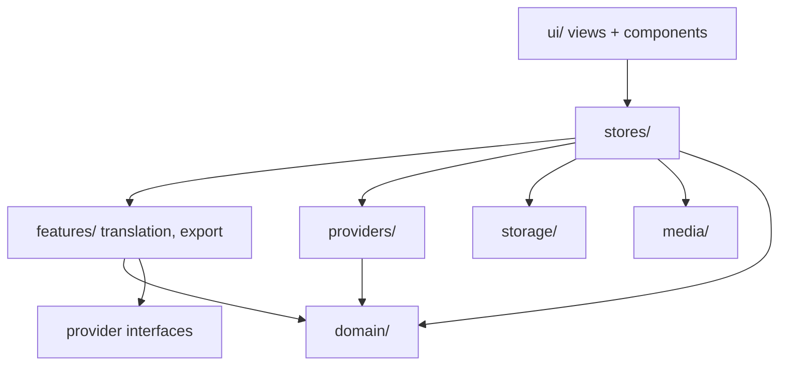
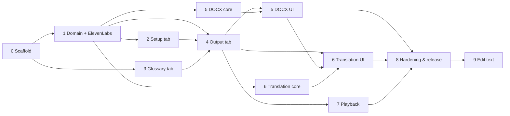

# DeScribe — Development Roadmap

*Written 2026-10-13. This is the master plan. Each phase has its own task file in [phases/](phases/). Release 2
(Projects, Phases 10–20) is designed in [PROJECTS.md](PROJECTS.md).*

## 1. Purpose

Colleagues need a simple, safe way to turn recorded interviews and meetings (English, German and French at first;
any language ElevenLabs transcribes well since Phase 26) into readable transcripts. Each transcript has speaker labels and timestamps, can be listened to from any point, can
be translated to English, and downloads as a Word document.

The tool must be **one HTML file** shared on SharePoint. It runs locally in the browser and needs no installation,
no server and no IT approval. The only network traffic is calls to AI APIs, made with the user's own API keys.

The same source also builds a **Windows desktop app**, DeScribe from the Microsoft Store (D35, Phase 24): Tauri 2
with WebView2, packed as MSIX. The HTML file stays.

## 2. Scope

### In scope for v1
- Transcription via ElevenLabs Speech-to-Text (`scribe_v2`), with speaker diarization and word timestamps
- Setup: API key, file selection, language (auto/EN/DE/FR; 36 languages since Phase 26), optional number of
  speakers, zero-retention toggle
- A glossary of project terms, saved locally and sent as ElevenLabs `keyterms`
- Output view: speaker turns with timestamps, renameable speaker labels, autosave of the latest transcript
- `.docx` export (original or English)
- On-demand English translation via Claude or Gemini
- Click a turn to play the audio from that point

### Out of scope for v1 (see [phases/future.md](phases/future.md))
- AI audit / auto-correction of transcripts
- Other transcription providers
- Splitting, merging or reassigning turns
- Batch processing of several files, saving/opening transcript files, other export formats

## 3. User workflow

```
┌──────────── 1. Setup ────────────┐   ┌──────── 2. Glossary ────────┐   ┌────────────── 3. Output ───────────────┐
│ ElevenLabs API key [remember ☐]  │   │ Paste terms → [Add]         │   │ Uploading 45% → Transcribing 01:12      │
│ (Translation keys, optional)     │──▶│ term list: edit / delete    │──▶│ File · duration · language · speakers   │
│ Audio/video file  [Choose…]      │   │ [Clear all]  [Copy list]    │   │ Speakers: Speaker 1 → "Interviewer"…    │
│ Language: Auto ▾  Speakers: Auto │   │                             │   │ [00:00:03] Interviewer: …  (click=play) │
│ ☐ Zero retention (Enterprise)    │   │                             │   │ [Translate to English] [Original|English]│
│                         [Next ▶] │   │ [◀ Back]           [Run ▶]  │   │ [Download .docx]     ▶ audio bar        │
└──────────────────────────────────┘   └─────────────────────────────┘   └─────────────────────────────────────────┘
```

## 4. Constraints

| Constraint | Consequence |
|---|---|
| Shared as one `.html` file, opened from `file://` | `vite-plugin-singlefile`. Everything is inlined. Page origin is `null`, so every API must allow CORS (verified, see reference docs). |
| Runs locally, apart from AI API calls | No backend. Keys live in the browser. A CSP limits `connect-src` to the 3 API hosts. |
| Mostly TypeScript; npm and Vite available | Vue 3 + TS + Vite toolchain |
| Edge/Chrome on Windows | Target Chromium only. Firefox is best-effort. |
| Single maintainer | Keep it simple: no router, no UI kit, few dependencies, strong tests |
| A desktop app from the Store as well (D35) | A second build, `vite build --mode desktop`, embedded by Tauri in `src-tauri/`. Its own CSP in `tauri.conf.json`, with the same three hosts. `__DESKTOP__` is the only switch in `src/`. |

## 5. Architecture

### Folder layout

```
index.html                      Vite entry (CSP injected at build time only)
vite.config.ts                  a function of mode: vue() + viteSingleFile() + csp plugin + defines; `desktop` mode
                                drops the single file and the CSP meta and writes dist-desktop/
src-tauri/                      the desktop app (D35): tauri.conf.json (window, CSP), capabilities/ (none granted),
                                src/ (a bare Tauri app and its launch splash), icons/ (from source.svg), msix/
                                (Package.appxmanifest + Assets, for winapp)
src/
  main.ts, App.vue              shell: AppHeader (top row), current view, footer (the Settings link)
  env.d.ts                      types for the build-time defines (__APP_VERSION__, __BUILD_DATE__, __DESKTOP__)
  stores/                       Pinia stores (orchestration; the only place that wires providers ↔ UI)
    nav.ts                      mode (Home · Transcribe · Project · Settings), Transcribe's step + guards
    settings.ts                 keys (via storage/secrets) + Verify key, prefs, selected File + file check
    glossary.ts                 term list, persisted on every change
    job.ts                      transcription job state machine
    transcript.ts               current TranscriptDoc (shallowRef), view version, speaker renames, text edits,
                                autosave; its project link: saving back to the folder with the change check (D25)
    translation.ts              translation job state machine
    playback.ts                 audio object URL, attach + source match, current time, active turn, follow
    export.ts                   builds the .docx (busy + error state) and starts the download
    savedData.ts                "Clear saved data" (About): glossary, prefs, last transcript, project folder + text cache
    project.ts                  project folder: connect / reconnect, the recent projects (D49), project file + brief,
                                sessions (cached text) and their summaries, the saved chats, rescan on focus, keyword
                                search, Copy text, the session-file and chat-file writes
    pipeline.ts                 Add to project / Summarise / Regenerate: a queue of save → translate → summarise,
                                Resume, Cancel, the statuses it adds (queued, running, failed)
    chat.ts                     the project chat: the conversation, its frozen snapshot, streaming (parsed once a
                                frame), Stop, Try again, New chat, the notices; saving it to chats/, opening a saved
                                one and resuming it, a copy of a colleague's (D29); /compact (D33)
    unloadGuard.ts              the "Leave site?" confirmation while a job, translation or pipeline runs (one each)
  domain/                       PURE TS — no Vue, no DOM, no I/O
    transcript.ts               canonical types + formatTimestamp, formatDateTime, normalizeLanguage, languageName,
                                defaultSpeakerLabel, cleanTurnText / joinLines (edited turn text), isoDate
    text.ts                     plural, oneLine
    tokens.ts                   NormalizedToken / NormalizedTranscription (provider output, re-exported by providers)
    segmentation.ts             normalized tokens → speakers + turns
    buildTranscriptDoc.ts       assembles TranscriptDoc from provider result + source + request info
    glossary.ts                 parse / merge / validate terms
    filecheck.ts                size / duration validation against provider limits
    playback.ts                 findActiveTurnIndex (binary search)
    hash.ts                     hashText / hashParts (cyrb53, change detection only)
    corpus/                     sessionText.ts (doc → SessionText, transcriptHash), normalize.ts, query.ts,
                                search.ts (+ search.bench.ts), quoteCheck.ts, sessionKeys.ts (s1…sN), citation.ts
    summary.ts                  SessionSummary, SessionSummaryFile, NOT_DISCUSSED
    project.ts                  ProjectBrief, EMPTY_BRIEF, briefHash, ProjectFile, cleanLines
    sessionFiles.ts             project file names: sessionBaseName, classifySessionFile, SessionTranscriptFile
    chat.ts                     ChatFile (a saved chat, D29), its file name, chatTitle, historyOf, parseChatCommand,
                                randomAuthorName
  providers/
    index.ts                    getTranscriptionProvider, getLlmProvider, getAgentProvider(provider, …) (+ test overrides)
    errors.ts                   ProviderError (kind, status, userMessage, retryable), redactSecret, withoutSecret
    transcription/types.ts      TranscriptionProvider, NormalizedTranscription
    transcription/elevenlabs/   limits.ts, types.ts, request.ts, transport.ts (XHR), mapper.ts, errors.ts, provider.ts
    llm/types.ts                LlmProvider.generateStructured; the agent contract (AgentProvider, AgentTool, …)
    llm/models.ts               selectable models + defaults (one place to update), PROJECT_MODELS (Claude and
                                Gemini, projectProviderOf, projectModelLabel), GEMINI_THINKING, MODEL_PRICES
    llm/claude.ts, llm/gemini.ts  both stream generateStructured
    llm/agentLoop.ts            the project agent's loop, shared by both providers: conversation, streamed text,
                                re-sends, tools
    llm/claudeAgent.ts          the project agent with Claude: its streamed request and the checks of its reply
    llm/geminiAgent.ts          the same with Gemini: a streamed function-calling request (Phase 20)
  features/
    translation/                batching.ts, prompt.ts, translate.ts
    export/                     docxModel.ts (pure), docxRender.ts, download.ts, fileName.ts
    summary/                    schema.ts, prompt.ts, check.ts, themes.ts, summarise.ts (session summaries)
    agent/                      limits.ts, corpus.ts, context.ts, instructions.ts, tools.ts, answer.ts, ask.ts,
                                compact.ts (the project agent: caps, session cards, tools, checked answers, askProject,
                                compactChat)
  lib/
    zod.ts                      the only `zod` import: jitless config for the CSP + re-export (DECISIONS T8)
  media/
    probeDuration.ts            read duration via a temporary <audio> element
  storage/
    local.ts                    namespaced JSON read/write for localStorage/sessionStorage (try/catch)
    secrets.ts                  get/set/forget API keys, remember flag
    idb.ts                      last transcript autosave and its project link (idb-keyval), the `describe-v1` store
    schemas.ts                  TranscriptDocSchema, SessionTextSchema
    folder.ts                   File System Access (the only code that calls it): ProjectFolder, FolderError,
                                picker, permission, the remembered handle and the recent ones (+ fileSystemAccess.d.ts)
    projectFiles.ts             describe-project.json and sessions/*.transcript.json: schemas, read, write, list
    corpusCache.ts              SessionText cache per file (IndexedDB `describe-v1-corpus`)
    chatFiles.ts                chats/*.chat.json: schema, list, read, write with the change check
  ui/
    styles/tokens.css           colours, spacing, typography, speaker palette
    styles/base.css             global styles + shared classes (.button, .control, .hint, .visually-hidden, …)
    views/                      HomeView, SetupView, GlossaryView, OutputView, ProjectView, SettingsView
    components/                 AppHeader, StepFooter, ApiKeyField, FileDrop, LastTranscriptBanner, GlossaryEditor,
                                ConfirmDialog, JobStatus, TranscriptHeader, SpeakerPanel, TurnList, TurnItem,
                                VersionToggle, TranslateButton, TranslateDialog, ExportButton, ExportDialog, AudioBar,
                                AddToProjectButton, AddToProjectDialog, PipelineStatus, FolderNotice;
                                Analyse mode: ProjectHeader, BriefDialog, SessionList, SessionSummary, QuoteCard,
                                SummariseDialog, KeyDialog; the chat: ChatPane (Chat | Search),
                                ChatMessage, ChatCompaction, AnswerBlocks, ChatActivity, ChatInput, SessionSearch (its
                                Search mode), ChatList (the saved chats)
    composables/useConfirm.ts   promise-based confirmation, rendered by ConfirmDialog
    composables/useModalDialog.ts  native <dialog> open/close, Escape and focus return (ConfirmDialog,
                                BriefDialog)
    composables/useProjectUi.ts the Brief dialog, the Change chooser, the selected session, the sidebar's tab and the
                                chat pane's mode, shared by the Analyse mode components
    composables/useRovingListbox.ts  one Tab stop and arrow keys for a listbox (SessionList, ChatList)
    composables/useCopy.ts      Copy with "Copied" and the Ctrl+C fallback (QuoteCard)
    clipboard.ts                writeClipboard (Copy buttons)
    providerNames.ts            each LLM provider's name, company and key label, in the order the UI lists them
    speakerColor.ts             speaker index → `var(--speaker-N)`, cycling after 10 (D15)
  testing/
    transcriptDoc.ts            test only: makeDoc, makeLargeDoc, withTranslation (docs built from the fixtures)
    corpus.ts                   test only: makeCorpus (a seeded project corpus with planted phrases)
    claudeSse.ts                test only: a Claude response as the SSE stream the SDK reads
    geminiSse.ts                test only: a Gemini response as the SSE stream the SDK reads
    geminiAgent.ts              test only: the scripted fake fetch for the Gemini agent + builders (parts, usage, errors)
    summary.ts                  test only: makeSummaryReply (a valid summary reply quoting real turns)
    memoryFolder.ts             test only: an in-memory ProjectFolder (seed, failures, colleagues' changes, held reads)
    folderMocks.ts              test only: storage/folder.ts's browser side for store specs (picker, permission, handle)
    projectSeed.ts              test only: project folder files (project file, transcript, summary and chat files)
    projectSessions.ts          test only: small SessionTexts and ProjectSessions for component specs
    agent.ts                    test only: a scripted fake fetch for the agent (request n → reply n) + builders
    agentCorpus.ts              test only: a three-session corpus (English, German translated, French untranslated)
fixtures/
  elevenlabs/                   ElevenLabs responses and errors (from scripts/make-elevenlabs-fixtures.mjs)
  audio/                        short test recordings (from scripts/make-test-audio.mjs)
  large/                        3-hour response for test:perf (from scripts/make-large-fixture.mjs; gitignored)
tests/e2e/                      Playwright specs (file:// + route mocks): *.e2e.ts, *.perf.ts, helpers.ts,
                                projectFolder.ts (the fake project folder)
scripts/                        postbuild.mjs, verify-single-file.mjs, release.mjs, live-check-elevenlabs.mjs,
                                make-elevenlabs-fixtures.mjs, make-test-audio.mjs, make-large-fixture.mjs,
                                pack-desktop.mjs (the MSIX)
  spikes/                       fsa-probe.html, make-probe-files.mjs (Phase 10: the project folder on file://)
```

### Dependency direction



### Data flow of a run

1. `GlossaryView` "Run" → `job.start()`.
2. `job` reads settings (key, File, language, speakers, zero retention) and the glossary's valid terms. It then calls
   `ElevenLabsProvider.transcribe()` with an `AbortSignal` and an `onProgress` callback.
3. The provider POSTs multipart to ElevenLabs via XHR (for upload progress), maps the response, and returns a
   `NormalizedTranscription`.
4. `buildTranscriptDoc()` segments the tokens into turns and adds source and request metadata, producing a
   `TranscriptDoc`.
5. `transcript` store holds the doc (`shallowRef`) and autosaves it to IndexedDB. `OutputView` renders it.
6. Optional steps: translation adds `doc.translations.en`, the export builds a `.docx` from the doc, and playback
   seeks an `<audio>` element.

## 6. Canonical data model

This model is the contract between all phases. It lives in `src/domain/transcript.ts` and is created in Phase 0
(types only).

```ts
export const TRANSCRIPT_SCHEMA_VERSION = 1 as const;

export type LanguageHint = 'auto' | 'en' | 'de' | 'fr';
export type TranscriptVersion = 'original' | 'en';
export type LlmProviderId = 'claude' | 'gemini';

export interface SourceInfo {
  fileName: string;
  fileSize: number;            // bytes
  mimeType: string;            // '' if the browser does not know
  lastModified: number;        // File.lastModified (ms epoch)
  durationSec: number | null;  // probed in the browser; null if unknown
}

export interface TranscriptionRequestInfo {
  provider: 'elevenlabs';
  model: string;               // 'scribe_v2'
  languageHint: LanguageHint;
  numSpeakers: number | null;  // null = auto
  zeroRetention: boolean;
  keyterms: string[];          // exactly what was sent
}

export interface TranscriptionResultInfo {
  providerTranscriptId: string | null;
  languageCode: string;        // as returned by the provider, e.g. 'deu'
  languageProbability: number | null;
  audioDurationSec: number | null;
}

export interface Speaker {
  id: string;                  // provider speaker id, e.g. 'speaker_0'
  label: string;               // user-editable; default 'Speaker 1', 'Speaker 2', …
}

export interface Word {
  text: string;
  start: number;               // seconds
  end: number;
  logprob: number | null;      // kept for the future AI audit
}

export interface Turn {
  id: string;                  // 't1', 't2', … stable within a doc
  speakerId: string;
  start: number;               // seconds
  end: number;
  text: string;
  words: Word[];
}

export interface Translation {
  provider: LlmProviderId;
  model: string;
  createdAt: string;           // ISO
  texts: Record<string, string>; // turnId → translated text (complete for all turns)
}

export interface TranscriptDoc {
  schemaVersion: typeof TRANSCRIPT_SCHEMA_VERSION;
  id: string;                  // uuid
  createdAt: string;           // ISO
  source: SourceInfo;
  request: TranscriptionRequestInfo;
  result: TranscriptionResultInfo;
  speakers: Speaker[];         // in order of first appearance
  turns: Turn[];               // chronological
  translations: { en?: Translation };
}
```

**Segmentation rules** (implemented in Phase 1, `domain/segmentation.ts`):
- A new turn starts when the speaker changes. Spacing tokens never trigger a change.
- If a turn has run longer than **90 s**, it is split after the next word that ends a sentence (`.?!…`). If no
  sentence ends before **120 s**, it is split at the next word.
- A missing `speaker_id` becomes `speaker_0`. Tokens with missing timestamps take the times of their neighbours.
- Speakers are labelled `Speaker 1…N` in order of first appearance.
- Timestamps are displayed as `HH:MM:SS`.

## 7. Phases

MVP = Phases 0–5. Each phase is sized for one agent session (or a few) and ends in a working, tested build.

| # | Phase | Hard dependencies | Can run in parallel with | Status |
|---|---|---|---|---|
| 0 | [Scaffold & single-file build](phases/00-scaffold.md) | – | – | ☑ Done |
| 1 | [Domain model & ElevenLabs provider](phases/01-domain-elevenlabs.md) | 0 | 3 | ☑ Done (live checks V1–V3, V5 done; V4 open) |
| 2 | [Setup tab](phases/02-setup-tab.md) | 1 | 3, 5-core, 6-core | ☑ Done |
| 3 | [Glossary tab](phases/03-glossary-tab.md) | 0 | 1, 2 | ☑ Done |
| 4 | [Output tab: job, transcript view, speakers, autosave](phases/04-output-tab.md) | 1, 2, 3 | 5-core, 6-core | ☑ Done (live EN/DE/FR check + V4 timing open) |
| 5 | [DOCX export](phases/05-docx-export.md) | 1 (core) · 4 (UI) | 6-core, 7 | ☑ Done |
| 6 | [English translation (Claude / Gemini)](phases/06-translation.md) | 1 (core) · 4, 5 (UI) | 7 | ☑ Done (live L3 check open) |
| 7 | [Audio playback](phases/07-audio-playback.md) | 4 | 5, 6 | ☑ Done |
| 8 | [Hardening & release](phases/08-hardening-release.md) | 0–7 | – | ☑ Done (manual Edge/Chrome checklist, V4 and L3 open) |
| 9 | [Edit transcript text](phases/09-edit-text.md) | 8 | – | ☑ Done |
| 10 | [Spike: project folder on `file://` and OneDrive](phases/10-folder-spike.md) | – | 11, 12, 13, 16 | ☑ Done (go; a check on a Demant-managed laptop is open) |
| 11 | [Home page and modes](phases/11-home-modes.md) | – | 10, 12, 13, 16 | ☑ Done |
| 12 | [Corpus core: session text, keyword search, quote check](phases/12-corpus-core.md) | – | 10, 11 | ☑ Done |
| 13 | [Summary core: schema, prompt, check, streaming](phases/13-summary-core.md) | 12 | 10, 11 | ☑ Done (live checks S1–S3 open) |
| 14 | [Project folder: connect, brief, sessions, search box](phases/14-project-folder.md) | 10–13 | 16 | ☑ Done (manual OneDrive and Demant-laptop checks open) |
| 15 | [Add to project and session summaries](phases/15-add-to-project.md) | 14 | 16 | ☑ Done (live checks S1–S3 and manual row 17 open) |
| 16 | [Project agent core](phases/16-agent-core.md) | 12, 13 | 10, 11, 14, 15 | ☑ Done (live checks A1–A4 open) |
| 17 | [Project chat](phases/17-project-chat.md) | 15, 16 | – | ☑ Done (live check A1 and manual row 18 open) |
| 18 | [Hardening release 2](phases/18-release-2.md) | 10–17, 19–22 | – | ☐ Not started (release 2 is in 1.1.0, not yet given to colleagues: D40) |
| 19 | [Gemini for the pipeline and summaries](phases/19-gemini-summaries.md) | 15 | 16, 17 | ☑ Done (live checks G1–G3 and manual row 19 open) |
| 20 | [Gemini for the project agent](phases/20-gemini-agent.md) | 16, 17, 19 | – | ☑ Done (live checks A1–A4 with Gemini, and manual row 20, open) |
| 21 | [Chat history in the project folder](phases/21-chat-history.md) | 14, 16, 17, 20 | – | ☑ Done (live checks H1–H3 open) |
| 22 | [Compacting a chat with `/compact`](phases/22-chat-compaction.md) | 17, 20, 21 | – | ☑ Done (live check C1 open) |
| 24 | [Desktop shell and the Store pipeline](phases/24-desktop-shell.md) | – | 23 | ☑ Done (Task 8, the Store submission, and the work-laptop checklist W1–W15 open) |
| 26 | [Recordings in more languages](phases/26-more-languages.md) | – | 23, 25 | ☑ Done (live check V7 and manual row 21 open) |
| 27 | [Rescan the project every two minutes](phases/27-background-rescan.md) | 14 | 23, 25 | ☑ Done (manual row 15's two-minute step open) |
| 28 | [The agent sees its budget left](phases/28-budget-left.md) | 16, 20 | 23, 25 | ☑ Done (live checks A1–A3 open) |
| 29 | [Follow-up questions start from the text](phases/29-follow-ups-from-text.md) | 17, 21, 22 | 23, 25 | ☑ Done (live checks A2, H1 and H2 open) |
| 30 | [Chat settings: effort, tool calls and reading](phases/30-chat-settings.md) | 16, 20, 28, 29 | 23, 25 | ☑ Done (live check A3 open) |
| 31 | [Choose the project in Add to project](phases/31-choose-project.md) | 14, 15 | 23, 25 | ☑ Done (manual row 22 open) |
| 32 | [Launch splash and hidden start](phases/32-launch-splash.md) | 24 | 23, 25 | ☑ Done (manual check W16 open) |

Status values: ☐ Not started · ◐ In progress · ☑ Done.

Phases 0–9 are release 1. Phases 10–22 are release 2 (Projects). Their dependency
graph is in [PROJECTS.md](PROJECTS.md) §8, and the graph below covers release 1 only. Release 2 is in 1.1.0, with
Phases 9, 24 and 26, but 1.1.0 hasn't been given to colleagues. Phase 18 hardens it for the next release (D40).



"Core" means the pure, UI-free part of a phase: modules under `features/` and `providers/` with their unit tests.
An agent may build a phase's core as soon as its core dependency is done, and do the UI part once the UI
dependency is merged.

### Milestones

| Milestone | Phases | Outcome |
|---|---|---|
| M1 — MVP | 0–5 | Transcribe, view, rename speakers, download `.docx`. Can be shared with first pilot users. |
| M2 — Translation | 6 | English output for German/French recordings |
| M3 — Playback | 7 | Click a turn to listen |
| M4 — Release 1.0 | 8 | Polished, documented, released on SharePoint |
| M5 — Release 2 | 10–22 | Projects: a shared OneDrive folder of sessions, summaries and a project chat with checked quotes (Claude or Gemini), and keyword search. In 1.1.0; Phase 18's release is the first colleagues get (D40). |

## 8. How agents should work

1. Read [AGENTS.md](../AGENTS.md), this file, your phase file, and the reference docs it lists. For Phases 10–22,
   also read [PROJECTS.md](PROJECTS.md).
2. Branch `phase-N-<slug>`. Set the phase status to ◐ in the table above.
3. Implement the tasks. Keep to the contracts in the phase files. Do not change the canonical model without
   recording the change in [DECISIONS.md](DECISIONS.md) and in this file.
4. Meet the Definition of Done in AGENTS.md. Set the status to ☑ and fill in the phase file's *Handoff* section.

## 9. Reference

- [DECISIONS.md](DECISIONS.md) — what was decided and why
- [PROJECTS.md](PROJECTS.md) — release 2 (Projects): architecture and phase plan
- [AGENTIC_SEARCH.md](AGENTIC_SEARCH.md) — how the Project chat's agent searches, reads and quotes: its tools and caps
- [reference/elevenlabs-stt.md](reference/elevenlabs-stt.md) — ElevenLabs API facts, limits, open checks
- [reference/llm-providers.md](reference/llm-providers.md) — Claude and Gemini usage from the browser
- [reference/file-system-access.md](reference/file-system-access.md) — the project folder on `file://` and OneDrive
- [reference/desktop.md](reference/desktop.md) — the desktop app: build, MSIX, the Store, the W1–W15 checklist
- [USER_GUIDE.md](USER_GUIDE.md), [RELEASING.md](RELEASING.md), [TESTING.md](TESTING.md) and
  [../CHANGELOG.md](../CHANGELOG.md) — for colleagues, releases and testing
